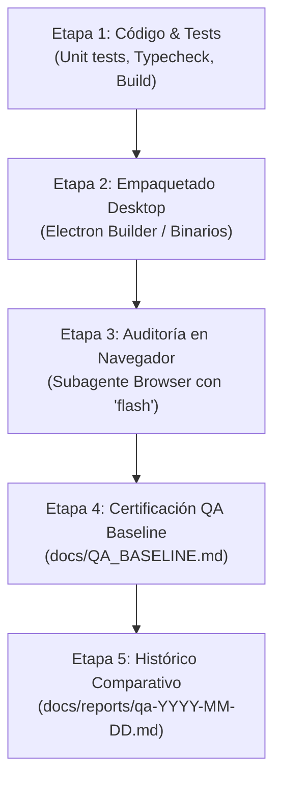

# Verificación Total (Full-Stack QA, Packaging & Browser Audit)

Habilidad integral para auditar, probar de extremo a extremo y certificar la calidad de una aplicación antes de dar por buena una iteración, un cambio crítico o una nueva release.

Combina verificación estricta de código, empaquetado de producción, navegación interactiva mediante un subagente web (`browser`), prevención de consumo redundante de tokens mediante **QA Baseline** y generación de informes históricos comparativos.

---

## 1. Cuándo Activar esta Skill

Activa esta skill de inmediato ante cualquiera de los siguientes disparadores:
- El usuario pide: *"haz una prueba"*, *"comprueba que funciona"*, *"úsalo como usuario"*, *"busca bugs"*, *"verifica todo"*, *"haz un test general"*.
- Antes de publicar una nueva versión, tag de Git o Release (`.exe`, instalador, binario).
- Tras implementar un cambio que afecte a múltiples módulos o al flujo principal de la interfaz.
- Cuando se quiera comparar la salud actual de la aplicación respecto a informes de calidad anteriores (`docs/reports/`).

---

## 2. Modos de Operación

La skill opera por defecto en **Modo Completo**, pero soporta ejecución modular si el usuario lo solicita:

| Modo | Etapas Involucradas | Cuándo Usarlo |
| :--- | :--- | :--- |
| **Completo (`full`)** *(Por defecto)* | **Etapa 1 + 2 + 3 + 4 + 5** | Auditoría integral o cierre de hitos. |
| **Solo Código (`code-only`)** | **Etapa 1** | Pruebas rápidas de regresión matemática o tipado sin tocar UI. |
| **Solo Navegador (`browser-qa`)** | **Etapa 3** | Cuando el código ya compila y se quiere probar solo la interfaz. |
| **Pre-Release (`pre-release`)** | **Etapa 1 + 2 + 3 + 4 + 5** + Validación de GitHub Release | Preparación formal de ejecutables de producción. |

---

## 3. Protocolo Secuencial de las 5 Etapas

### Etapa 1: Verificación Estática y Pruebas Unitarias
1. **Tests unitarios**: Ejecutar el runner de pruebas del proyecto (`npm run test` / `pytest` / etc.). Todo debe pasar al 100%.
2. **Chequeo de tipos estricto**: Ejecutar `npm run typecheck` (`tsc --noEmit`). 0 errores tolerados.
3. **Compilación de producción**: Ejecutar `npm run build` para asegurar que Vite/Webpack/Rollup genera los bundles sin fallos de importación.

### Etapa 2: Empaquetado Binario / Desktop (Si aplica)
1. Si el proyecto tiene empaquetado de escritorio (ej. Electron Builder):
   - Ejecutar la generación del ejecutable (`npx electron-builder --win portable` o instalador).
   - Verificar que el binario `.exe` se genere con un tamaño coherente en la carpeta de distribución (`dist-win/`).

### Etapa 3: Auditoría Interactiva en Vivo (Subagente `browser`)
1. **Arrancar servidor de desarrollo**: Iniciar el servidor local en segundo plano (`npm run dev`) con `IsDaemon: true`.
2. **Desplegar el subagente de navegación**:
   - Invocar `invoke_subagent` con `TypeName: "browser"`, `Model: "flash"` y `Role: "Web Application QA Tester"`.
   - **Misiones obligatorias del subagente**:
     - Cargar `http://localhost:PORT` y verificar carga inicial limpia.
     - Interactuar con elementos interactivos (pan, zoom, arrastre de nodos, modales).
     - Rellenar formularios y crear entidades de prueba para verificar la reactividad del estado.
     - Probar filtros, conmutadores de vista y cambio de tema (Claro/Oscuro).
     - **Caza de errores**: Capturar excepciones de consola, advertencias no controladas y desbordamientos visuales.
     - Tomar capturas de pantalla de evidencia.
3. **Cierre de servidor**: Tras recibir el reporte del subagente, liberar el proceso del servidor si no se requiere más.

### Etapa 4: Certificación en Línea Base (QA Baseline)
1. Consultar [docs/QA_BASELINE.md](file:///docs/QA_BASELINE.md).
2. Si se han validado nuevas funcionalidades o módulos, actualizar la tabla de módulos certificados con la fecha y versión actual.
3. Respetar la **Directiva de Impacto por Diff**: Ninguna conversación futura debe re-verificar módulos marcados como `APROBADO` a menos que el diff toque sus archivos.

### Etapa 5: Registro Histórico Versionado (Para comparaciones futuras)
1. Crear o actualizar un informe fechado en `docs/reports/qa-[version-o-fecha].md`.
2. Formato del informe histórico:
   - **Versión auditada** y fecha/hora.
   - **Métricas cuantitativas**: Tests pasados, tiempo de compilación, peso de bundles/ejecutables.
   - **Pruebas de interfaz realizadas**: Lista de acciones del subagente y enlaces a capturas de pantalla.
   - **Comparativa con la versión previa**: Qué bugs se corrigieron, qué módulos nuevos se certificaron y si hubo regresiones.
   - **Oportunidades de mejora de UX detectadas**.

---

## 4. Reglas Inviolables y Token Hygiene

1. **Ahorro de Contexto (Subagente Obligatorio)**:
   - Jamás intentes simular la navegación web o hacer scraping con comandos de consola pesados cuando se evalúe la interfaz de usuario. Delega siempre en el subagente `browser` con `Model: "flash"`.
2. **No re-probar lo certificado**:
   - Antes de iniciar pruebas masivas, lee `docs/QA_BASELINE.md`. Si el cambio actual solo modificó un archivo puntual, prueba únicamente ese archivo.
3. **Enlaces Clicables de Evidencia**:
   - Todo informe final debe incluir enlaces en formato markdown `[nombre](file:///ruta/absoluta)` a los ejecutables generados, informes y capturas de pantalla.
